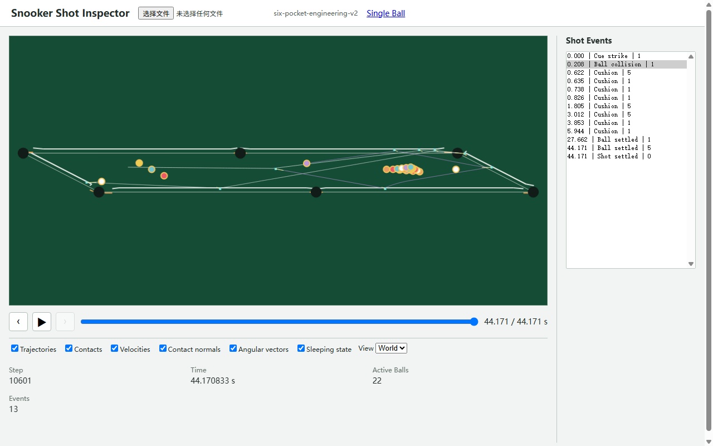
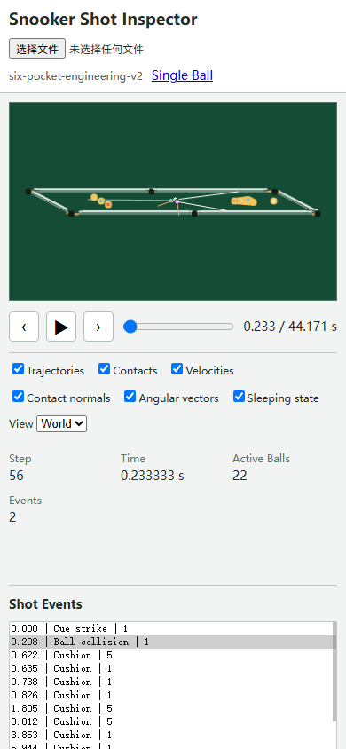
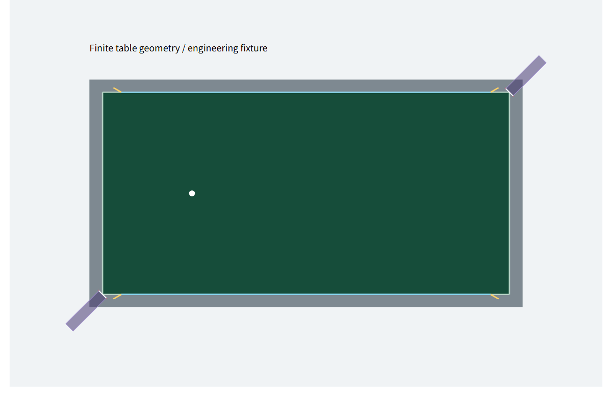
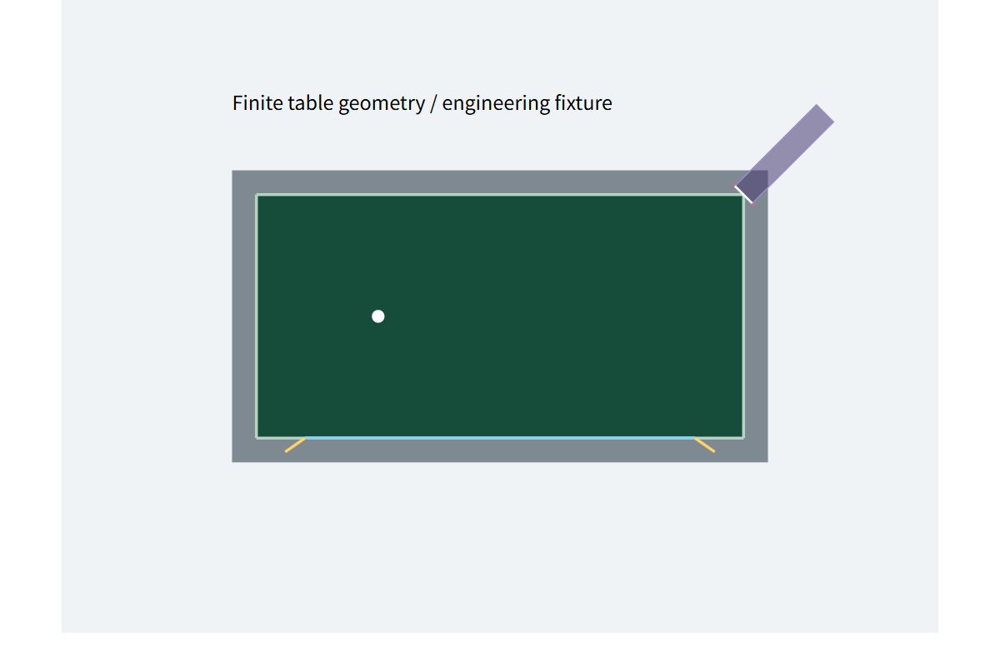
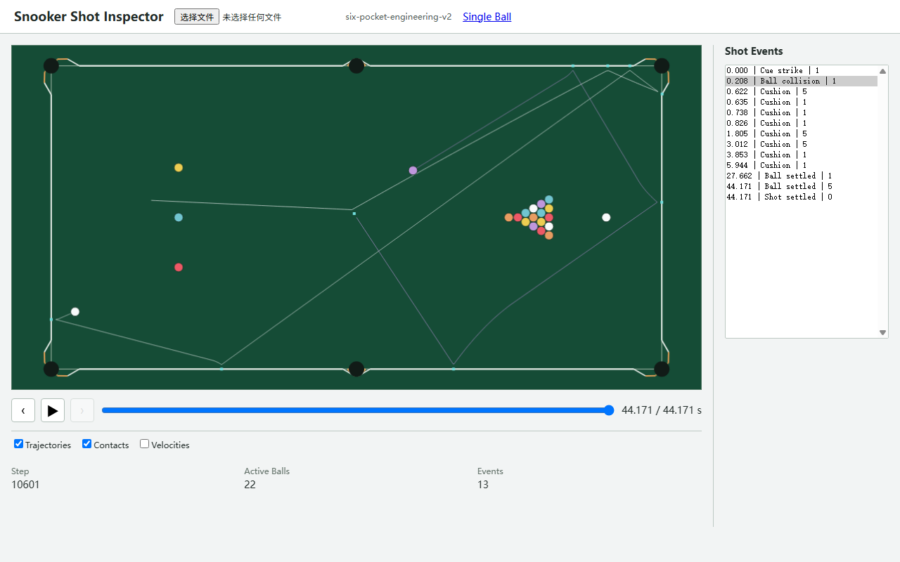
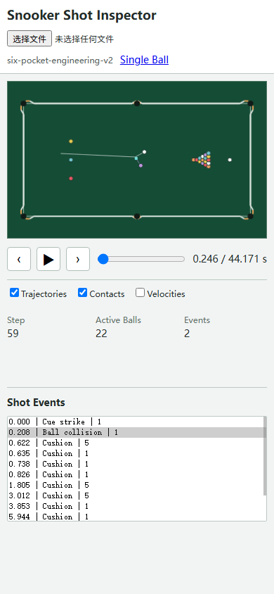
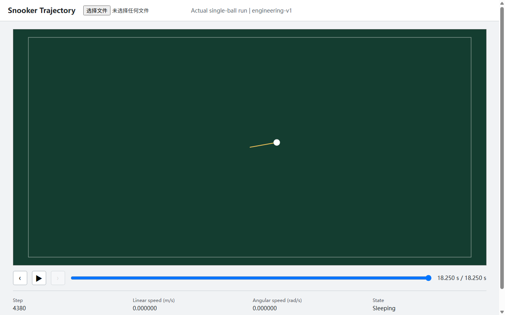
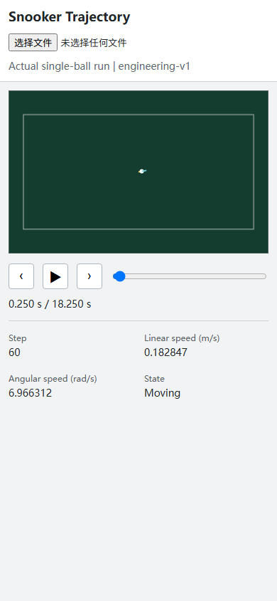

# Validation Archive

## 2026-11-19 独立核心补充任务

- `FND-008`、`VAL-001`、`VAL-002`、`REL-001` 的独立部分已推进到 REVIEW；`VAL-010` 已完成。
- `core-five-final3`：configure、Debug build/test、Release build/test 全部 exit 0，Debug/Release 各 94/94。物理实验测试会实际运行四个预设并验证 BallSettled、BallBall、Cushion、MouthEntered/PocketContact/Potted 事件。证据：[core-five-exit-codes.txt](evidence/core-five-exit-codes.txt)。
- 性能专项使用真实两球碰撞记录逐步/整杆/搜索/碰撞类型耗时，Release 样例包含非零 `ball_ball_time_ns`。摘要：[physics-performance-summary.txt](evidence/physics-performance-summary.txt)。
- 2D 查看器使用真实 22 球数据验证 World 投影、速度、角速度、接触法线、睡眠状态、事件跳转和时间轴；桌面/手机无横向溢出，1172 种画布采样颜色，无 JavaScript 异常。





Chrome/CDP 结果：[shot-viewer-world-result.json](evidence/shot-viewer-world-result.json)。UE Developer Settings、Map_PhysicsLab、3D 世界调试组件和 Unreal Insights 仍需 Unreal Engine 5.8.4 环境。

归档日期：2026-11-19

本文件是 `build-evidence/` 的精简长期摘要。它保留重要验收结论、关键失败修复、稳定性数据和浏览器截图索引，不保留编译中间文件、`.obj`、`.pdb`、`.exe` 或完整源码副本。

## 当前结论

- GitHub：`https://github.com/nh511/Snooke.git`
- 远程 `main`：`64803ba`，包含 AIC-005 零标准差 `normal_distribution` Debug 断言修复。
- UE 版本目标：Unreal Engine `5.8.4`；当前设备未安装 UE5，因此 UE 插件、编辑器、DataAsset、Actor、Blueprint、角色、UI、音效和打包验收仍未完成。
- 任务统计：`DONE 65/121`、`REVIEW 10`、`BLOCKED 2`、未列出任务 `TODO 44`。
- BLOCKED：`FND-002`、`FND-003`，原因是缺少 UE5 编辑器/真实 UE 资源验收，不是独立 C++ 核心失败。

## 阶段验收

| 阶段 | 干净副本 | Debug | Release | 重点 |
|---|---|---:|---:|---|
| 阶段 1 | `stage1-n18` | 56/56 | 56/56 | PHY-018、PHY-020、PHY-021，统一物理服务、闭合六袋桌、故障保护、22 球整杆 |
| 阶段 2 | `stage2-n18` | 68/68 | 68/68 | REP-001/002/003、VAL-003/004/005/006/007/008/009、COR-006 |
| 阶段 3 | `stage3-n19` | 90/90 | 90/90 | 规则、存档迁移、稳定性、联机设计、AIC-001 至 AIC-005 |

三个阶段的 `configure/build/test/exit-codes` 已精简复制到本目录：

- [stage1-exit-codes.txt](evidence/stage1-exit-codes.txt)
- [stage2-exit-codes.txt](evidence/stage2-exit-codes.txt)
- [stage3-exit-codes.txt](evidence/stage3-exit-codes.txt)

最终阶段独立副本 `stage3-n19` 的完整 CTest 是 Debug/Release 各 90/90，退出码全部为 0。后续规则和 AI 任务又增加了专项验证，最高全量回归达到 90 项；这里保留阶段级结果和关键专项结果，不复制构建目录。

## 关键功能证据

### 物理核心

- 快照 v3 保存袋口状态、袋口 ID、一次性落袋标志和事件游标；v2 可迁移到 v3。
- 六袋工程桌使用闭合边界检查，支持球碰球、库边、袋角、袋口、袋底、恢复和多球最早事件调度。
- 统一服务支持 `BeginShot`、`Step`、`IsSettled`、`GetEvents`、`SaveSnapshot`、`RestoreSnapshot`。
- 22 球开局、真实碰球、碰库、袋口捕获和中途存档恢复均通过；Debug/Release 输出哈希一致。

### 异常保护

- 故障码：`NonFinite`、`Penetration`、`VelocityExplosion`、`Timeout`、`EventLoop`、`LeftTable`、`PocketEscape`、`SolverError`。
- 故障记录使用 `snooker-fault-v2`，区分有效恢复检查点和原始坏状态诊断。
- 故障后服务冻结，后续 `Step` 不继续改变状态。
- 关键故障文件已保留：
  - [physics-fault.txt](evidence/faults/physics-fault.txt)
  - [physics-timeout.txt](evidence/faults/physics-timeout.txt)
  - [physics-eventloop.txt](evidence/faults/physics-eventloop.txt)

### 回放和导出

- `snooker-shot-v2` 内嵌 PhysicsBundle、初始快照、输入、完整事件、终态和结果。
- 独立重放逐事件、逐终态比较，中心基线和真实 22 球记录均通过。
- CSV 使用固定物理步、球 ID 顺序；JSON 保存参数、初终快照、事件和几何。
- 比较器在差异时报告第一处 `step/ball/field/expected/actual`。

### 规则和 AI

- 规则包括 Ball On、正常计分、母球犯规、首次接触、犯规值、多球进袋、回合、彩球复位、最终彩球、Free Ball、Miss 和 frame 结束。
- MatchState v1 可迁移到 v2；Snapshot v2 可迁移到 v3；旧 shot-v1 明确报告缺少完整参数包，不能假装可重放。
- AI 使用只读查询、Ghost Ball 候选、共享物理服务评估、真实重放和固定种子难度权重。
- AIC-005 的 Hard 难度不再构造 sigma 为 0 的 `std::normal_distribution`，解决了用户报告的 Debug Assertion 弹窗。

## 稳定性数据

Release 固定种子 424242 运行 2000 杆：

- 报告：[stability-2000-release.json](evidence/stability-2000-release.json)
- `faults=0`
- `elapsedMs=70734`
- 工作集：`4,202,496 -> 5,050,368` 字节
- 增长：`847,872` 字节，低于 10 MiB 限制
- 最大物理步：`1286`
- 最大单杆事件：`4`
- 结果哈希：`17146014793590329516`

CTest 的 50 杆 Debug/Release 稳定性测试也通过，内存增长为 0。

## 浏览器截图

### 桌面球桌几何





### 多球 Shot Inspector





Chrome/CDP 结果：[shot-viewer-result.json](evidence/shot-viewer-result.json)

- 桌面视口：`1280x800`
- 移动视口：`390x844`
- 真实加载：22 球、10602 帧、13 个事件
- 画布采样颜色：1116 种
- JS 异常：0
- 已验证：事件跳转、前后步进、播放、桌面/手机无横向溢出

### 旧单球查看器





## 重要失败和修复

- `PHY-018`：初始袋角接触时间期望只考虑端点，实际斜线段内部更早接触；改为端点/垂线段分开验证，没有放宽求解器容差。
- `PHY-019`：已处于 `Ejected` 时重复恢复事件；修正状态转换边沿，确保恢复事件只发一次。
- `PHY-020`：测试曾把坏快照修补后当成可重放状态；改为保存有效检查点和原始诊断分离，NaN/Inf 不伪造重放输入。
- `PHY-021`：台面碰撞冲量带来竖直速度；按不跳球模型在布面支撑处吸收竖直速度，并保留袋内三维运动。
- `PHY-021`：Windows 文本模式导致 CLI/API 文件多出 CR 字节；统一二进制/LF 输出后通过逐字节比较。
- `PHY-021/VAL-007`：袋边与斜面同时接触时重新查询选中其他片元；改为按原 `Primitive` 重验，仍检查点、法线、特征和穿透。
- `AIC-005`：Hard 难度 sigma 为 0 触发 MSVC Debug Assertion；Hard 现在完全跳过正态分布采样。

## 删除说明

归档后可以删除：

```text
D:\vibe coding\Snooker\build
D:\vibe coding\Snooker\build-evidence
```

删除后不会影响源码、测试、参数、基线、文档或 GitHub 开发。删除后需要重新生成本地构建目录才能运行测试：

```powershell
powershell.exe -NoProfile -ExecutionPolicy Bypass -File tools/Test-Current.ps1 -Run new-device
```

本归档保留约 180 KB 的关键截图、退出码、稳定性报告和故障文件。它不替代完整构建日志，但保留了判断项目当前状态、复现核心验证和理解历史修复所需的重点信息。
